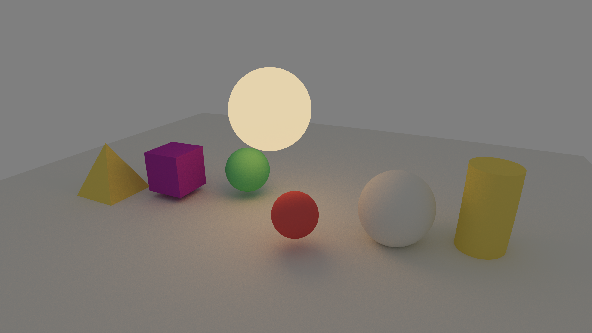

# Vulkan CUDA Raytracer Engine

Este repositorio contiene un motor de render basado en Vulkan y CUDA, con soporte de ray-tracing en GPU.

## Vista previa



## Cómo construir

1. Generar el proyecto con CMake:

```powershell
cmake -S . -B build
```

2. Construir el ejecutable:

```powershell
cmake --build build
```

3. Ejecutar el binario:

```powershell
build\Debug\engine.exe
```


## Estructura del proyecto

- `src/` contiene el código fuente en C, C++ y CUDA.
- `shaders/` contiene los shaders utilizados.